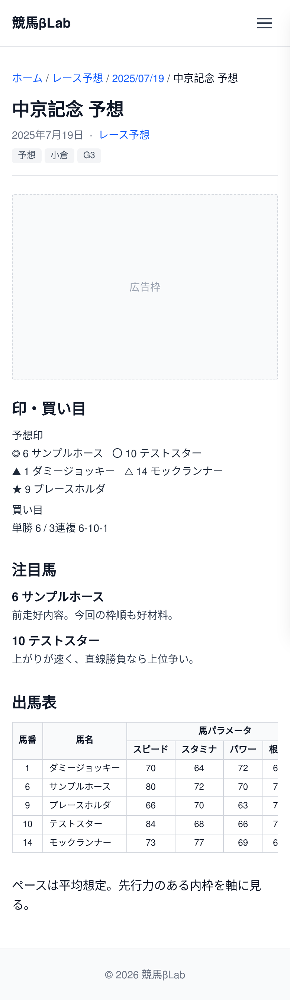

# UI設計：レース予想詳細

上位文書: [画面設計書 §3.5](../../screen_design.md#35-レース予想) / [本ディレクトリ README](../README.md)  
共通: [common.md](../common.md)  
関連: [一覧](./list.md) / [開催日](./day.md)

## 1. 基本情報

| 項目 | 内容 |
| ---- | ---- |
| URL | `/race-predict/{YYYYMMDD}/{venueSlug}-{number}R` |
| 説明 | Markdown から変換された、1レースの予想記事を表示する |
| 対応コンポーネント | `PredictPost` |
| og:type | `article` |

例: `/race-predict/20261025/kyoto-11R`（2026年10月25日・京都11R）。  
`venueSlug` は [アーキテクチャ設計書の競馬場スラッグ](../../architecture_design.md#レース予想の-url) に従う。該当記事がないときは 404 とする。

## 2. レイアウト

* パンくず（ホーム > レース予想 > 開催日 > 記事タイトル）
  * 「レース予想」は一覧 `/race-predict`
  * 開催日は `/race-predict/{YYYYMMDD}`
* タイトル（h1）・公開日・カテゴリ・タグを表示
* 印・買い目、注目馬、出馬表は詳細記事の Front Matter から表示する
* 印・買い目を表示
  * 予想印（◎、〇、▲、△、★）と馬番・馬名
  * 買い目（単勝など）
* 注目馬を表示
  * 馬番・馬名と、注目する理由
* 出馬表を表で表示する。列は次のとおり
  * 馬番
  * 馬名
  * 馬パラメータ（スピード / スタミナ / パワー / 根性 / 賢さ）
  * タイム指数
  * 対戦指数
  * レーティング
* 狭い画面では出馬表を横スクロールする
* 本文（Markdown → HTML）を表示
* 所定位置に広告枠を確保
* パンくずの階層は [ブログ記事](../blog/article.md) と異なる。本文の前に印・買い目、注目馬、出馬表を置く

**ワイヤーフレーム**
```
+---------------------------------------------------------------------------------------------+
|                                           Header                                            |
+---------------------------------------------------------------------------------------------+
|  ホーム > レース予想 > 2026/10/25 > 記事タイトル                                            |
|                                                                                             |
|  記事タイトル（h1）                                                                         |
|  公開日 / カテゴリ / タグ                                                                   |
|  +---------------------------------------------------------------------------------------+  |
|  | 広告枠                                                                                |  |
|  +---------------------------------------------------------------------------------------+  |
|                                                                                             |
|  印・買い目                                                                                 |
|  +---------------------------------------------------------------------------------------+  |
|  | ◎  1 サンプルホース                                                                   |  |
|  | 〇  3 ...    ▲  5 ...    △  7 ...    ★  9 ...                                         |  |
|  | 買い目  単勝 1                                                                        |  |
|  +---------------------------------------------------------------------------------------+  |
|                                                                                             |
|  注目馬                                                                                     |
|  +---------------------------------------------------------------------------------------+  |
|  | 1 サンプルホース                                                                      |  |
|  |   先行力があり、好位を取れそう                                                        |  |
|  | 5 ...                                                                                 |  |
|  |   ...                                                                                 |  |
|  +---------------------------------------------------------------------------------------+  |
|                                                                                             |
|  出馬表                                                                                     |
|  +----+--------------+----------------------------------+----------+--------+------------+  |
|  |馬番|     馬名     |           馬パラメータ           |タイム指数|対戦指数|レーティング|  |
|  +----+--------------+--------+--------+------+----+----+----------+--------+------------+  |
|  |    |              |スピード|スタミナ|パワー|根性|賢さ|          |        |            |  |
|  +----+--------------+--------+--------+------+----+----+----------+--------+------------+  |
|  | 1  |サンプルホース|   72   |   68   |  70  | 65 | 80 |    85    |   90   |    112     |  |
|  +----+--------------+--------+--------+------+----+----+----------+--------+------------+  |
|  | 2  |...           |        |        |      |    |    |          |        |            |  |
|  +----+--------------+--------+--------+------+----+----+----------+--------+------------+  |
|                                                                                             |
|  +---------------------------------------------------------------------------------------+  |
|  |                                                                                       |  |
|  | 本文（Markdown）                                                                      |  |
|  |                                                                                       |  |
|  +---------------------------------------------------------------------------------------+  |
+---------------------------------------------------------------------------------------------+
|                                           Footer                                            |
+---------------------------------------------------------------------------------------------+
```

<!-- ui-design-screenshot:begin -->

**実装スクリーンショット**（Storybook 自動撮影）



<!-- ui-design-screenshot:end -->

## 9. 変更履歴

| 日付 | 版 | 内容 | 担当 |
| ---- | -- | ---- | ---- |
| 2026-08-10 | 1.0 | 初版 | βshort |
| 2026-08-10 | 1.1 | home.md の粒度に合わせて簡素化 | βshort |
| 2026-10-24 | 1.2 | URL を `/race-predict/{YYYYMMDD}/{venueSlug}-{number}R` に変更。パンくずに開催日を追加 | βshort |
| 2026-10-29 | 1.3 | 印・買い目、注目馬、出馬表（馬パラメータ・タイム指数・対戦指数・レーティング）をワイヤーに追加 | βshort |
| 2026-10-29 | 1.4 | 印・買い目、注目馬、出馬表を表示し、実装スクリーンショットを更新 | βshort |
