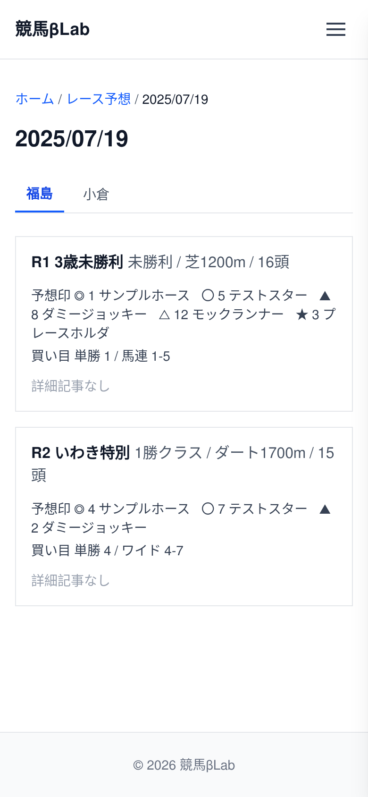

# UI設計：レース予想ページ（開催日）

上位文書: [画面設計書 §3.5](../../screen_design.md#35-レース予想) / [本ディレクトリ README](../README.md)  
共通: [common.md](../common.md)  
関連: [一覧](./list.md) / [詳細](./article.md)

## 1. 基本情報

| 項目 | 内容 |
| ---- | ---- |
| URL | `/race-predict/{YYYYMMDD}` |
| 説明 | 指定した開催日の競馬場・レースごとの予想印と買い目を表示する |
| 対応コンポーネント | `PredictDay` |
| og:type | `website` |

URL の日付はハイフンなしの `YYYYMMDD`（例: `/race-predict/20261025`）。元データは `src/articles/predict/{YYYY-MM-DD}/index.md`。

## 2. レイアウト

* パンくず（ホーム > レース予想 > 開催日）
* 見出しはその開催日
* 競馬場タブで場を切り替える
* 選択した場のレース一覧を表示する
  * レース番号、クラス、レース名、コース、頭数
  * 予想印（◎、〇、▲、△、★）
  * 買い目（単勝など）
* 詳細記事があるレースは `/race-predict/{YYYYMMDD}/{venueSlug}-{number}R` へ遷移する（例: `/race-predict/20261025/kyoto-11R`）
* 詳細記事がないレースは「詳細記事なし」とする
* 該当日の開催データがないときは 404 とする

`venueSlug` は競馬場英名の小文字。対応は [アーキテクチャ設計書の競馬場スラッグ](../../architecture_design.md#レース予想の-url) に従う。

**ワイヤーフレーム**
```
+--------------------------------------------------------+
|                        Header                          |
+--------------------------------------------------------+
|  ホーム > レース予想 > 2026/10/25                      |
|                                                        |
|  2026/10/25                                            |
|                                                        |
|  [ 京都 ] [ 東京 ]                                     |
|  +---------------------------------------------+      |
|  | R1  レース名  クラス  コース  頭数           |      |
|  | 予想印  ◎ 〇 ▲ △ ★                         |      |
|  | 買い目  単勝 ...                            |      |
|  | [詳細記事へ]                                |      |
|  +---------------------------------------------+      |
|  | R2  レース名  クラス  コース  頭数           |      |
|  | 予想印  ◎ 〇 ▲ △ ★                         |      |
|  | 買い目  単勝 ...                            |      |
|  | （詳細記事なし）                            |      |
|  +---------------------------------------------+      |
|  | ...                                         |      |
+--------------------------------------------------------+
|                        Footer                          |
+--------------------------------------------------------+
```

<!-- ui-design-screenshot:begin -->

**実装スクリーンショット**（Storybook 自動撮影）



<!-- ui-design-screenshot:end -->

## 9. 変更履歴

| 日付 | 版 | 内容 | 担当 |
| ---- | -- | ---- | ---- |
| 2026-10-24 | 1.0 | 開催日ページを新設。旧レース予想一覧の場・レース表示を移した | βshort |
