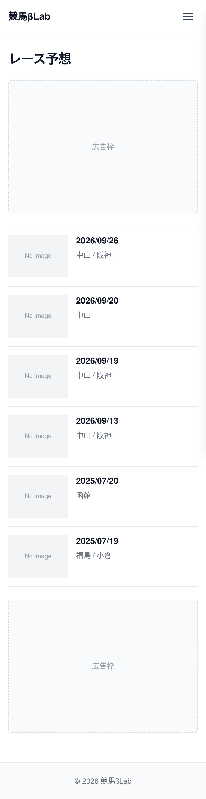

# UI設計：レース予想一覧

上位文書: [画面設計書 §3.5](../../screen_design.md#35-レース予想) / [本ディレクトリ README](../README.md)  
共通: [common.md](../common.md)  
関連: [開催日](./day.md) / [詳細](./article.md)

## 1. 基本情報

| 項目 | 内容 |
| ---- | ---- |
| URL | `/race-predict` |
| 説明 | 開催日ごとのレース予想ページを、ブログ一覧と同じカードで新しい順に表示する |
| 対応コンポーネント | `PredictList` |
| og:type | `website` |

## 2. レイアウト

* ページ見出し「レース予想」を表示
* 開催日カードを新しい順で縦に一覧表示
  * サムネイル
  * タイトル（開催日。例: `2026/10/25`）
  * その日の競馬場
* 1ページあたり最大10件。11件目以降はページ下部のページネーションで切り替え
* カードタップでその日のレース予想ページ（`/race-predict/{YYYYMMDD}`）へ遷移
* 開催データが 0 件のときは「開催データはまだありません。」を表示

**ワイヤーフレーム**
```
+--------------------------------------------------------+
|                        Header                          |
+--------------------------------------------------------+
|  レース予想                                            |
|                                                        |
|  +---------------------------------------------+      |
|  | サムネ  2026/10/25                           |      |
|  |         京都 / 東京                          |      |
|  +---------------------------------------------+      |
|  +---------------------------------------------+      |
|  | サムネ  2026/10/24                           |      |
|  |         京都 / 新潟                          |      |
|  +---------------------------------------------+      |
|  | ...（最大10件・縦並び）                      |      |
|                                                        |
|  <  1  2  3  ...  >                                    |
+--------------------------------------------------------+
|                        Footer                          |
+--------------------------------------------------------+
```

<!-- ui-design-screenshot:begin -->

**実装スクリーンショット**（Storybook 自動撮影）



<!-- ui-design-screenshot:end -->


## 9. 変更履歴

| 日付 | 版 | 内容 | 担当 |
| ---- | -- | ---- | ---- |
| 2026-08-10 | 1.0 | 初版 | βshort |
| 2026-08-10 | 1.1 | home.md の粒度に合わせて簡素化 | βshort |
| 2026-08-10 | 1.2 | レイアウト記述に合わせてワイヤーフレームを更新（予想印・買い目） | βshort |
| 2026-08-10 | 1.3 | 詳細記事リンクをワイヤーフレームに反映 | βshort |
| 2026-08-10 | 1.4 | 基本情報の説明をレイアウト（開催日・場単位）に合わせて修正 | βshort |
| 2026-10-24 | 2.0 | URL を `/race-predict` に変更。開催日カードの一覧にし、場・レースの予想印は開催日ページへ移した | βshort |
